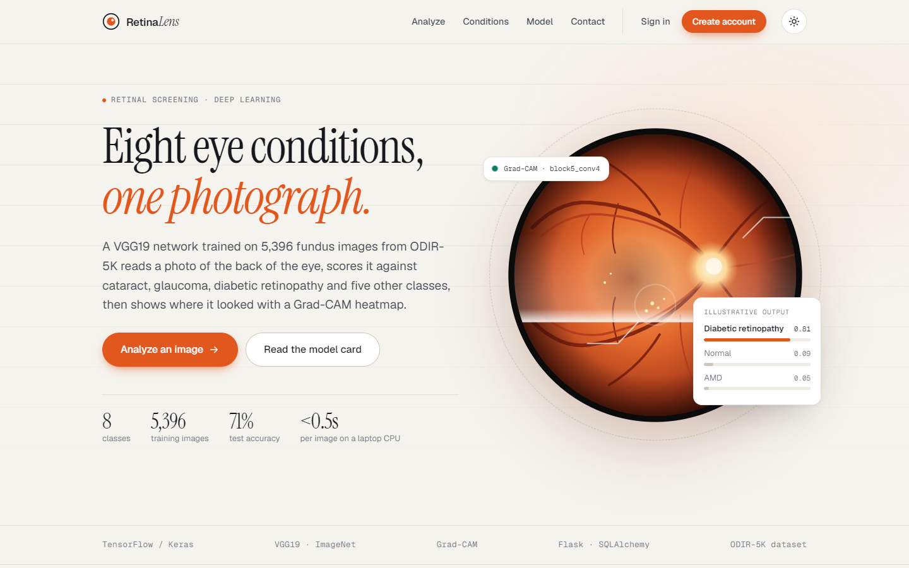
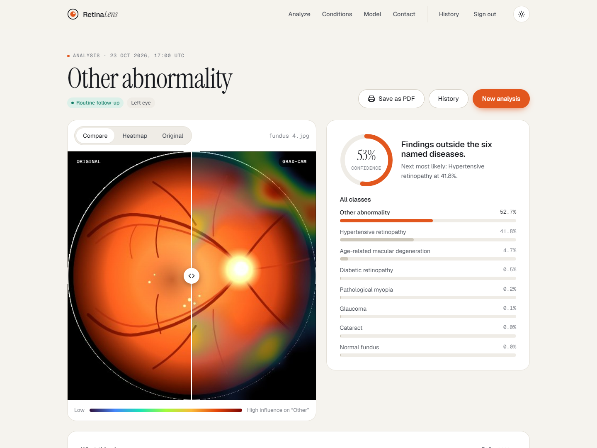
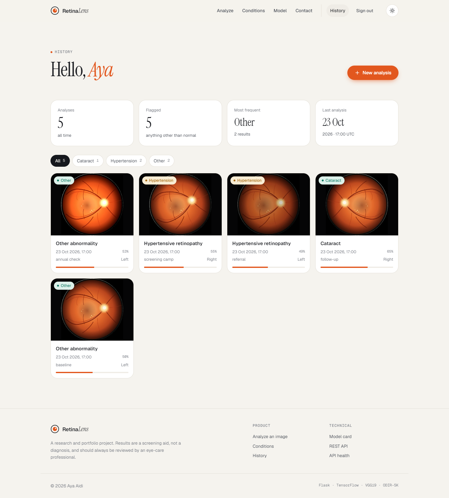
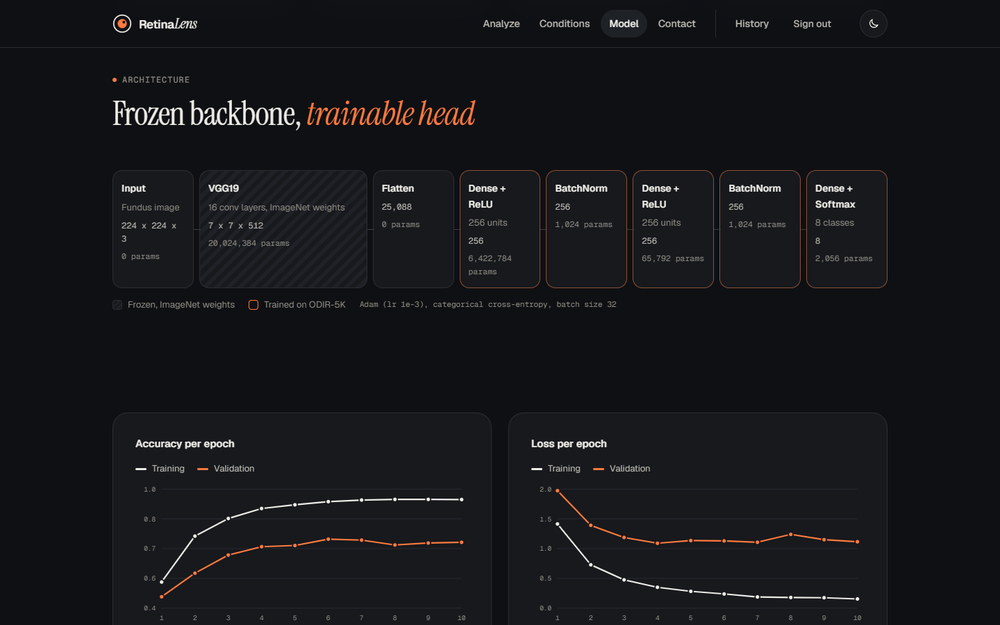
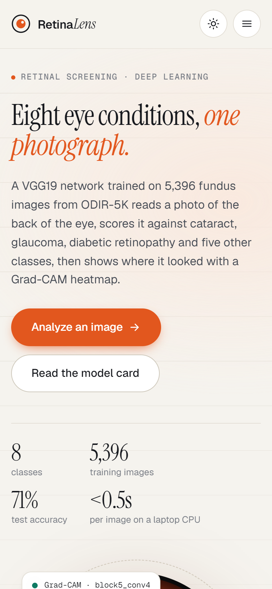

# RetinaLens: Ocular Disease Recognition

Deep-learning screening of retinal fundus photographs. A VGG19 transfer-learning model, trained on the ODIR-5K dataset, sorts an image into one of eight classes (normal, cataract, diabetic retinopathy, glaucoma, hypertensive retinopathy, pathological myopia, AMD, other). A Grad-CAM heatmap shows which regions of the retina drove the prediction.

The project covers the full path from research notebook to usable product: training, a fixed and tested inference pipeline, a web interface with accounts and history, and a JSON API.



| Analysis result with Grad-CAM comparison | Private analysis history |
| --- | --- |
|  |  |

| Model card (dark theme) | Mobile |
| --- | --- |
|  |  |

## Features

- **Eight-class prediction** with the full probability distribution, not just a single label
- **Grad-CAM explanations** computed in the same forward pass as the prediction, with an interactive before/after slider
- **Automatic preprocessing**: EXIF rotation, any colour mode (RGBA, grayscale, palette, 16-bit), cropping of the black camera frame to the retinal disc
- **Input quality checks** that flag low resolution, bad exposure, and images that do not look like fundus photographs
- **Accounts and history**: hashed passwords, CSRF protection, per-user image storage, filtering by condition, deletion
- **Privacy by default**: anonymous uploads are processed in memory and never written to disk
- **REST API** at `/api/v1/predict` and `/api/v1/health`
- **Model card page** with architecture, training curves, class balance and documented limitations
- **Condition reference** with fundus signs, symptoms and typical next steps for each class
- **Printable report** (save as PDF), light and dark themes, responsive down to phone width
- **Demo mode**: when the trained weights are missing, the app still runs end to end with clearly labelled synthetic scores
- **Tests and CI**: 48 pytest tests covering preprocessing, the Keras/Grad-CAM path, auth, access control and the API

## Bugs fixed from the first version

| Problem | Effect | Fix |
| --- | --- | --- |
| Images were fed to the model as **RGB**, but training used `cv2.imread` (**BGR**) | Red and blue swapped on every prediction; fundus photos are red-dominant, so this silently degraded accuracy | Preprocessing now reproduces the training pipeline exactly, with a regression test |
| PNGs with an alpha channel, grayscale or palette images | Crash in `model.predict` (wrong channel count) | Every upload is converted to 3-channel RGB first |
| `ocular_disease_model.h5` is not in the repository | App crashed on startup | Weights are optional; the app falls back to a clearly labelled demo mode |
| Sign-in, sign-up and contact forms posted to routes that did not exist | 405 / 404 errors | Real authentication and a contact form backed by SQLite |
| Prediction and home page shared the `/` route; no error handling for bad files | Confusing routing and unhandled exceptions on invalid uploads | Dedicated `/analyze` route, validation, friendly 404/413/500 pages |
| Hotlinked stock photos (some with expiring tokens) and four copy-pasted stylesheets | Broken images, inconsistent styling, no mobile layout | One design system, SVG illustrations, responsive layout |

## Quick start

```bash
python -m venv .venv
source .venv/bin/activate        # Windows: .venv\Scripts\activate

pip install -r requirements-ml.txt   # with TensorFlow, for real predictions
# or: pip install -r requirements.txt  (lighter, demo mode only)

python app.py                         # http://127.0.0.1:5000
```

The trained weights (`models/ocular_disease_model.h5`, about 160 MB) are stored with [Git LFS](https://git-lfs.com). Running `git lfs install` before cloning, or `git lfs pull` afterwards, downloads the real file instead of a small pointer. A different model can be used through `ODR_MODEL_PATH`; the notebook and `training/train.py` (see below) both produce compatible files. If the weights are missing or TensorFlow is not installed, the app starts in demo mode and says so on every result.

### Docker

```bash
docker build -t retinalens .
docker run -p 8000:8000 retinalens
```

### Configuration

| Variable | Default | Purpose |
| --- | --- | --- |
| `SECRET_KEY` | generated and stored in `instance/` | Session signing key; required in production |
| `DATABASE_URL` / `POSTGRES_URL` | `sqlite:///instance/ocular.db` | Any SQLAlchemy URL; `postgres://` URLs are switched to the psycopg driver automatically |
| `ODR_MODEL_PATH` | `models/ocular_disease_model.h5` | Location of the Keras weights |
| `ODR_DEMO_MODE` | `auto` | `auto` falls back to demo when weights are missing, `on` forces demo, `off` refuses to start without a model |
| `PORT`, `HOST`, `FLASK_DEBUG` | `5000`, `127.0.0.1`, `0` | Development server options |

## Deployment

Accounts, analyses and their images are all stored in the database, so the app works on hosts without a persistent disk as long as `DATABASE_URL` points to a real database.

### Full version with the model: Docker hosts

TensorFlow (~1.4 GB) and the weights (~160 MB) need a container host. On [Hugging Face Spaces](https://huggingface.co/spaces), a free Docker Space with 16 GB of RAM, the repository can be pushed as is. The Space's `README.md` needs `sdk: docker` and `app_port: 8000` in its front matter, and `SECRET_KEY` goes in the Space secrets. Render, Railway and Fly.io work with the same Dockerfile, given at least 2 GB of RAM.

### Lightweight demo: Vercel

Vercel functions are limited to about 250 MB, far below TensorFlow's size. The `.vercelignore` therefore leaves out the weights and anything not needed at runtime. Vercel installs only `requirements.txt` (no TensorFlow, no OpenCV, about 90 MB), and the hosted site runs in **demo mode** with synthetic scores, clearly labelled on every page.

1. Import the GitHub repository in Vercel. Flask is detected from `app.py` automatically.
2. Add a Postgres database from the Vercel Marketplace (Neon has a free tier). It sets `DATABASE_URL` for the project.
3. Add a `SECRET_KEY` environment variable, for example the output of `python -c "import secrets; print(secrets.token_hex(32))"`.
4. Redeploy.

Without a database, Vercel falls back to SQLite in `/tmp`. The site works, but accounts disappear whenever the function restarts.

## API

```bash
curl http://localhost:5000/api/v1/health

curl -F "file=@fundus.jpg" "http://localhost:5000/api/v1/predict?heatmap=1"
```

```json
{
  "prediction": { "key": "glaucoma", "label": "Glaucoma", "confidence": 0.8731 },
  "probabilities": [
    { "key": "glaucoma", "name": "Glaucoma", "short_name": "Glaucoma", "probability": 0.8731 },
    "... all eight classes, sorted ..."
  ],
  "warnings": [],
  "demo": false,
  "inference_ms": 372,
  "heatmap_jpeg_base64": "..."
}
```

Errors return JSON with an `error` field: 400 when no file is sent, 413 when it exceeds 10 MB, 422 when it is not a usable image.

## The model

| | |
| --- | --- |
| Dataset | [ODIR-5K](https://www.kaggle.com/datasets/andrewmvd/ocular-disease-recognition-odir5k), 5,396 images used |
| Architecture | VGG19 (ImageNet, frozen) → Flatten → Dense 256 → BN → Dense 256 → BN → Softmax 8 |
| Parameters | 26.5M total, 6.5M trainable |
| Input | 224 × 224 × 3, BGR, raw 0–255 pixels |
| Training | Adam, categorical cross-entropy, 10 epochs, batch 32 |
| Test accuracy | **71.0%** on 810 held-out images (best validation accuracy 74.8%) |

### Known limitations

- **Overfitting**: training accuracy reaches 95% while validation plateaus around 73%.
- **Probable data leakage** in the notebook: `full_df.csv` lists each patient twice and the class lists are built from patient-level keywords, so the same image can appear in both train and test. The 71% figure is likely optimistic.
- **Class imbalance**: 1,818 diabetic retinopathy images versus 374 hypertension.
- **Single-label output** for a problem that is multi-label in reality.
- **One dataset**: no evaluation on other cameras or populations.

### Improved training script

`training/train.py` keeps the same architecture and input contract, so its output works with the app unchanged, and addresses the issues above:

- each image is used once, labelled from its own eye's keywords; ambiguous multi-condition images are dropped
- train/validation/test are split **by patient**, with an assertion against leakage
- balanced class weights, augmentation, dropout, early stopping and learning-rate decay
- `metrics.json` with per-class precision/recall and a confusion matrix

```bash
pip install -r requirements-ml.txt
kaggle datasets download -d andrewmvd/ocular-disease-recognition-odir5k
unzip ocular-disease-recognition-odir5k.zip -d odir5k
python training/train.py --data odir5k --out models
```

## Project structure

```
app.py                     entry point (python app.py / gunicorn app:app)
ocular/
  __init__.py              app factory, error handlers
  config.py                settings and environment variables
  models.py                User, Analysis, ContactMessage (SQLAlchemy)
  conditions.py            class order + reference content for each condition
  model_card.py            numbers from the notebook, chart helper
  ml/
    preprocessing.py       loading, fundus crop, BGR conversion, quality checks, heatmap overlay
    predictor.py           Keras predictor with Grad-CAM, demo predictor, factory
  views/                   pages, auth, analysis/history, JSON API blueprints
  templates/, static/      Jinja templates, CSS design system, vanilla JS
training/train.py          reproducible training with a patient-level split
tests/                     pytest suite
Ocular_Disease_Recognition_final_version.ipynb   original research notebook
```

## Tests

```bash
pip install -r requirements-dev.txt
pytest
```

The Keras tests build a tiny model with the same nested-backbone structure as the real one and run the actual loading and Grad-CAM code. They are skipped automatically when TensorFlow is not installed (as in CI).

## Roadmap

- Retrain with `training/train.py` and publish per-class metrics on the model card
- Swap VGG19 for EfficientNet or ConvNeXt and fine-tune the top blocks
- Multi-label output (sigmoid head) to match ODIR's real annotations
- Paired left/right eye input, as in the original ODIR challenge

## Disclaimer

This is a research and portfolio project. Its output is a screening aid, not a medical diagnosis, and must be reviewed by a qualified eye-care professional.

---

Built by **Aya Aidi**: Flask · TensorFlow/Keras · NumPy · SQLAlchemy
